# context.md — Master Plan: Cronos E-commerce

> **Regla de oro:** este archivo se revisa al inicio de CADA consulta y se actualiza al cerrar cada fase
> (checklist, decisiones, cambios de esquema). Si el código y este documento divergen, se corrige uno de los dos en el mismo commit.
>
> **Idioma:** documentación en español · todo código, comentarios, nombres de clases/tablas/columnas, mensajes de commit en **inglés**.
> **Estado actual:** `Fase 0 (Planeación)` completada · esperando orden para iniciar **Fase 1**.
> **Última revisión:** 2026-10-28

---

## 0. Índice

1. [Objetivo y alcance](#1-objetivo-y-alcance)
2. [Cobertura de la retrospectiva del usuario](#2-cobertura-de-la-retrospectiva-del-usuario)
3. [Decisiones arquitectónicas (ADR resumido)](#3-decisiones-arquitectónicas-adr-resumido)
4. [Stack tecnológico exacto](#4-stack-tecnológico-exacto)
5. [Arquitectura hexagonal / SOLID](#5-arquitectura-hexagonal--solid)
6. [Estructura del monorepo](#6-estructura-del-monorepo)
7. [Docker e infraestructura](#7-docker-e-infraestructura)
8. [GraphQL: diseño de API](#8-graphql-diseño-de-api)
9. [EDA: eventos, listeners y colas](#9-eda-eventos-listeners-y-colas)
10. [Estrategia de caché Redis](#10-estrategia-de-caché-redis)
11. [Auditoría e inmutabilidad](#11-auditoría-e-inmutabilidad)
12. [Evaluación del ER entregado y mejoras](#12-evaluación-del-er-entregado-y-mejoras)
13. [Esquema de base de datos (PostgreSQL)](#13-esquema-de-base-de-datos-postgresql)
14. [Diagrama ER](#14-diagrama-er)
15. [Seguridad y fraude](#15-seguridad-y-fraude)
16. [Observabilidad, calidad y CI/CD](#16-observabilidad-calidad-y-cicd)
17. [Checklist de fases](#17-checklist-de-fases)
18. [Preguntas abiertas / supuestos](#18-preguntas-abiertas--supuestos)
19. [Bitácora de cambios](#19-bitácora-de-cambios)

---

## 1. Objetivo y alcance

Plataforma e-commerce de alto rendimiento, multi-país y multi-moneda, vendiendo **listones por metro** (cantidad decimal, corte a medida) y **otros productos por pieza**, con pedidos personalizados.

| Pieza | Tecnología | Rol |
|---|---|---|
| `backend/` | Laravel 11+ · GraphQL (Lighthouse) · PostgreSQL · Redis | API única, dominio, colas, auditoría |
| `admin/` | React + Vite + TS · Tailwind · shadcn/ui · TanStack Table · Apollo Client | Panel de administración |
| `storefront/` | React (Next.js, ver ADR-09) · Tailwind · Apollo Client | Tienda para clientes |

Restricciones duras: **solo GraphQL** (nada de REST salvo webhooks entrantes de terceros y health checks), **EDA** para lógica pesada, **auditoría inmutable**, **soft deletes** en tablas transaccionales/catálogo, **ULID** públicos, **Docker** de nivel enterprise.

---

## 2. Cobertura de la retrospectiva del usuario

| # | Requerimiento | ¿Cubierto por el plan original? | Solución en este plan | Fase |
|---|---|---|---|---|
| R1 | Pagos en línea en ambos países | Parcial (pasarelas por interfaz, sin noción de país) | Tabla `markets` (país → moneda, impuestos, pasarelas, transportistas). `PaymentGatewayPort` con adaptadores por país/método; `payments`, `payment_transactions`, `webhook_events` (idempotencia). Multi-moneda con snapshot de tipo de cambio. | 4, 6 |
| R2 | Catálogo con fotos, precios e inventario | Sí | Media Library polimórfica + PIM + Kardex. Se añade precio por moneda/mercado (`product_prices`). | 2, 3, 4, 5 |
| R3 | Listones **por metro** y otros **por pieza** | **NO cubierto** (cantidades enteras implícitas) | `products.sell_unit` (`piece`/`meter`), `min_quantity`, `quantity_step`, `max_quantity`; cantidades `NUMERIC(12,3)` en carrito, order_items y kardex; opción de **rollo completo** (`roll_length`) y corte; validación de múltiplos del paso. Precio = precio por unidad base. | 3, 5, 6 |
| R4 | Cálculo de costos de envío y generación de guías | Parcial (solo `shipping_carrier`/`tracking_number` en `orders`) | Puerto `ShippingCarrierPort` (Envia.com primero). Tablas `shipping_methods`, `shipments`, `shipment_packages`, `shipment_labels` (PDF vía Job), cotización cacheada en Redis. Peso/dimensiones por producto; para listones el peso se calcula por metro (`weight_per_unit`). | 7 |
| R5 | Rastreo de pedidos | Parcial (`order_histories`) | `shipment_tracking_events` (inmutable), webhooks de transportista → cola, query `trackOrder` pública con token + panel del cliente, notificaciones. | 7 |
| R6 | Actualización automática de inventario | Sí (Kardex) | Listener en cola `ReserveInventory` → `ConfirmSale` con `lockForUpdate`; reservas con TTL; stock desnormalizado por trigger/listener; alertas de stock bajo. | 5, 7 |
| R7 | Pedidos personalizados | **NO cubierto** | Módulo `CustomOrders`: `custom_order_requests` → `custom_order_quotes` (+ líneas) → aprobación del cliente → conversión a `orders` con `order_type = custom`; adjuntos vía Media; conversación (`custom_order_messages`); estados y auditoría. | 7 |

Requerimientos **implícitos** detectados (se proponen, requieren confirmación — ver §18): facturación fiscal por país (p. ej. CFDI en México), múltiples bodegas, cumplimiento de privacidad (LFPDPPP / GDPR-like), i18n del storefront.

---

## 3. Decisiones arquitectónicas (ADR resumido)

| ID | Decisión | Motivo |
|---|---|---|
| ADR-01 | **Monolito modular** (un deploy Laravel, bounded contexts internos) en vez de microservicios | Menor complejidad operativa; las fronteras hexagonales permiten extraer servicios luego. |
| ADR-02 | **Lighthouse-PHP** (schema-first SDL) + **Apollo Client** en ambos fronts, tipos con `graphql-codegen` | Un solo cliente, caché normalizada InMemoryCache, tipado end-to-end. |
| ADR-03 | **Dos esquemas GraphQL**: `/graphql` (storefront, público/cliente) y `/admin/graphql` (admin, RBAC estricto) | Superficie de ataque y complejidad separadas; límites de rate distintos. |
| ADR-04 | **ULID** como PK de entidades de negocio (tipo `char(26)`); `bigint identity` solo en tablas de apéndice masivo (`audits`, `inventory_movements`, `order_histories`, `shipment_tracking_events`) y catálogos pequeños (`tax_classes`, `currencies`, `markets`) | Evita enumeración; los ULID ordenables mantienen buen rendimiento de índices B-tree. |
| ADR-05 | **Dinero**: `NUMERIC(14,2)` + librería `brick/money`; **cantidades**: `NUMERIC(12,3)`. Nunca `float`. | Exactitud financiera y soporte para metros. |
| ADR-06 | **Inmutabilidad reforzada a nivel BD** (triggers que rechazan `UPDATE/DELETE` en `audits`, `inventory_movements`, `order_histories`, `shipment_tracking_events`, `payment_transactions`) | La inmutabilidad no debe depender solo de código de aplicación. |
| ADR-07 | **Outbox pattern** (`outbox_messages`) para eventos críticos (`OrderCreated`, pago confirmado) + `afterCommit` en colas | Garantiza que no se pierdan eventos si hay caída entre commit y dispatch. |
| ADR-08 | **Redis separado por responsabilidad** (instancias o DBs lógicas): `cache` (allkeys-lru), `queue` (noeviction, AOF), `session/cart/ratelimit` (volatile-ttl) | Evitar que la política de evicción de caché destruya colas o carritos. |
| ADR-09 | **Storefront con Next.js (App Router, SSR/ISR) + Apollo** *(propuesto, confirmar)* | SEO (OpenGraph/Schema.org) y rendimiento percibido; el prompt permite Next.js o Helmet. El Admin es SPA (Vite). |
| ADR-10 | Auth: **Sanctum** (tokens personales con abilities, cookie SPA opcional) integrado vía directivas `@guard`/mutaciones `login`, `refresh`, `logout` | Más simple que Passport; no se requiere OAuth server. Socialite (Google) para login social. |
| ADR-11 | RBAC con **spatie/laravel-permission** (teams no requeridos) + `@can` en SDL + Policies | Estándar maduro; permisos granulares `recurso.acción`. |
| ADR-12 | Cálculo de precios/impuestos/envíos en **servicios de dominio puros** (sin Eloquent) | Testeable, reutilizable por carrito, checkout y cotizaciones. |
| ADR-13 | **Idempotencia** obligatoria en mutaciones críticas (`createOrder`, `pay`) con header `Idempotency-Key` almacenado en Redis + tabla `idempotency_keys` | Reintentos de red seguros. |
| ADR-14 | Búsqueda de catálogo: **PostgreSQL FTS (`tsvector` + `pg_trgm`)** en MVP; puerto `CatalogSearchPort` permite migrar a Meilisearch/OpenSearch | Evita infraestructura extra al inicio. |

---

## 4. Stack tecnológico exacto

> Las versiones se **fijan en Fase 1** consultando la última estable y se registran en §19. "Mínimo" = piso permitido.

### Backend
| Componente | Elección | Mínimo |
|---|---|---|
| Lenguaje / framework | PHP + Laravel | PHP 8.3 · Laravel 11 (preferir la última estable) |
| GraphQL | `nuwave/lighthouse` | v6 |
| Base de datos | PostgreSQL | 16 (extensiones: `pgcrypto`, `pg_trgm`, `citext`, `btree_gin`, `ltree`) |
| Pooling | PgBouncer (transaction mode) | — |
| Redis | Redis | 7.x (cliente `phpredis`) |
| Colas / supervisión | `laravel/horizon` | — |
| Servidor de app | Laravel Octane (FrankenPHP o RoadRunner) *o* PHP-FPM + Nginx | decidir en Fase 1 tras benchmark; Octane requiere código sin estado |
| Auth | `laravel/sanctum`, `laravel/socialite` | — |
| RBAC | `spatie/laravel-permission` | — |
| Auditoría | `owen-it/laravel-auditing` (modelo `Audit` extendido: ULID, JSONB, solo inserción) | — |
| Medios | Implementación propia hexagonal inspirada en Spatie (polimórfica); `intervention/image` (o `libvips`) + `ffprobe`/`exiftool` para metadata | — |
| Dinero | `brick/money` | — |
| Exportación | `openspout/openspout` (streaming `.xlsx`, bajo consumo de memoria) | — |
| PDF | `dompdf` o `Browsershot` (Job) | — |
| Pruebas | Pest, Larastan (nivel 8+), Laravel Pint, Infection (mutation, opcional), Deptrac (reglas hexagonales) | — |
| Observabilidad | Sentry, OpenTelemetry, `laravel/telescope` (solo dev), Prometheus exporter | — |
| Seguridad (CI) | `composer audit`, Trivy, gitleaks, Semgrep | — |

### Frontend (ambos)
| Componente | Admin | Storefront |
|---|---|---|
| Framework | React 18+/19 + Vite + TypeScript estricto | Next.js (App Router) + React + TypeScript estricto |
| Estilos | Tailwind CSS | Tailwind CSS |
| UI | **shadcn/ui** (Radix) | Componentes propios + Radix primitives |
| Tablas | **TanStack Table** (server-side, cursor pagination) | — |
| Datos | Apollo Client (InMemoryCache + `typePolicies`, paginación `relayStylePagination`) | Apollo Client (+ `@apollo/client-integration-nextjs`) |
| Formularios | React Hook Form + Zod | React Hook Form + Zod |
| Tipos GraphQL | `graphql-codegen` (client preset) | `graphql-codegen` |
| Cropper de avatar | `react-easy-crop` | `react-easy-crop` (perfil) |
| Pruebas | Vitest + Testing Library + Playwright | Vitest + Testing Library + Playwright |
| SEO | — | Metadata API de Next, JSON-LD (Schema.org), OpenGraph |
| Calidad | ESLint, Prettier, `tsc --noEmit`, Storybook (opcional) | ídem |

---

## 5. Arquitectura hexagonal / SOLID

Cada **bounded context** (módulo) tiene 4 capas con dependencia **siempre hacia adentro**:

```
Interfaces (GraphQL resolvers, Console, Webhook controllers)   ← driving adapters
        │  llama a
Application (Commands/Queries, Handlers, DTOs, Event Listeners)  ← casos de uso
        │  depende de
Domain (Entities, Value Objects, Domain Services, Events, Ports) ← sin framework
        ▲  implementado por
Infrastructure (Eloquent repos, Redis, Gateways, Carriers, Storage)  ← driven adapters
```

Reglas (aplicadas con **Deptrac** en CI — el build falla si se violan):
1. `Domain` no importa `Illuminate\*`, Eloquent, ni nada de `Infrastructure`/`Interfaces`.
2. Resolvers GraphQL **solo** construyen un Command/Query DTO, lo pasan a un Handler (vía bus) y devuelven el resultado. Cero lógica de negocio.
3. Toda E/S externa (pago, envío, storage, email, push, tipo de cambio) se declara como **Port** (interface) en `Domain`/`Application` con adaptador en `Infrastructure`, enlazado en un `ServiceProvider` por módulo.
4. Eloquent vive **solo** en `Infrastructure/Persistence`; el dominio usa **Repository interfaces**. Los modelos Eloquent llevan Observers (caché) y `Auditable`.
5. Eventos de dominio → Listeners de `Application` en cola (`ShouldQueue`, `afterCommit`).
6. SOLID: S — un handler por caso de uso; O — nuevas pasarelas/transportistas = nuevos adaptadores, sin tocar el core; L/I — ports pequeños y específicos; D — inyección por contenedor, nunca `new` de colaboradores en el core.

### Bounded contexts
`Identity` (users, auth, RBAC, profiles) · `Audit` · `Media` · `Settings` (identidad y configuración) · `Catalog` (PIM, taxonomía) · `Pricing` (precios, promos, cupones, monedas, impuestos) · `Inventory` · `Cart` · `Checkout/Payment` · `Order` · `Shipping` · `CustomOrder` · `Notification` · `Wishlist` · `Reporting` · `Seo`.

---

## 6. Estructura del monorepo

```
cronos-ecommerce/
├── context.md                      # este archivo
├── docker/                         # Dockerfiles, nginx, php.ini, redis.conf, pg init
├── docker-compose.yml              # dev
├── docker-compose.prod.yml         # referencia prod / override
├── Makefile                        # make up / test / lint / codegen / migrate
├── .github/workflows/              # CI/CD
├── backend/
│   ├── app/                        # Kernel mínimo, Providers
│   ├── src/
│   │   └── <Module>/
│   │       ├── Domain/             # Entities, ValueObjects, Events, Ports, Services
│   │       ├── Application/        # Commands, Queries, Handlers, DTOs, Listeners
│   │       ├── Infrastructure/     # Persistence (Eloquent), Adapters, Observers
│   │       └── Interfaces/         # GraphQL (Mutations, Queries, Directives), Console, Http (webhooks)
│   ├── graphql/                    # schema.graphql (storefront), admin.graphql, módulos *.graphql
│   ├── database/{migrations,seeders,factories}
│   ├── deptrac.yaml · phpstan.neon · pint.json
│   └── tests/{Unit,Feature,Architecture}
├── admin/                          # React + Vite
├── storefront/                     # Next.js
└── packages/                       # compartido: graphql-codegen config, eslint-config, tailwind-preset, tokens de diseño
```

---

## 7. Docker e infraestructura

**Principios enterprise:** imágenes multi-stage, base fijada por digest/versión, usuario **no-root**, filesystem `read_only` donde sea posible, `HEALTHCHECK` en cada servicio, secretos por Docker/Swarm secrets o variables inyectadas (nunca en imagen), límites de CPU/memoria, redes segmentadas, volúmenes nombrados, logs JSON a stdout, SBOM + escaneo Trivy en CI, `.dockerignore` estricto, build con BuildKit y caché.

| Servicio | Imagen / notas |
|---|---|
| `app` | PHP-FPM (o Octane) multi-stage: `base → vendor → dev → prod` con OPcache + JIT tunado |
| `nginx` | Reverse proxy, headers de seguridad, gzip/brotli, rate-limit L7 |
| `queue-default`, `queue-notifications`, `queue-media`, `queue-payments` | Workers Horizon por cola con prioridades y supervisor |
| `scheduler` | `schedule:work` (un solo contenedor) |
| `postgres` | PostgreSQL 16 + init de extensiones; volumen persistente |
| `pgbouncer` | Pooling transaccional |
| `redis-cache`, `redis-queue`, `redis-session` | Config y política de evicción distinta por instancia (ADR-08) |
| `mailpit` | SMTP de desarrollo |
| `minio` | S3 compatible para medios (dev); S3 real en prod |
| `admin` / `storefront` | Dev: Vite/Next con HMR · Prod: build estático (nginx) / Node standalone |
| `traefik` (prod) | TLS (Let's Encrypt), enrutamiento por host |

Entornos: `local`, `staging`, `production` (variables por `.env.*.example`; `.env` jamás commiteado).

---

## 8. GraphQL: diseño de API

- **Esquemas separados** (ADR-03) y modularizados en `graphql/<module>/*.graphql` con `#import`.
- **Paginación por cursor** (Relay connections) en toda lista; **nunca** offset en tablas grandes.
- **Seguridad:** límite de profundidad y complejidad, introspección desactivada en producción, *persisted queries* (APQ) para el storefront, `@throttle` por operación, `@guard` + `@can` por campo/mutación, validación con `@rules`/FormRequests de dominio.
- **IDs públicos = ULID** (`ID!`). Los IDs bigint internos jamás se exponen.
- **Errores:** formato estándar con `extensions.code` (`VALIDATION`, `UNAUTHENTICATED`, `FORBIDDEN`, `CONFLICT`, `RATE_LIMITED`, `OUT_OF_STOCK`…) y `correlation_id`.
- **N+1:** `@with`/`@lazyLoad`/DataLoaders y pruebas que fallan si superan N queries.
- **Cache de red:** directiva `@cache` de Lighthouse con tags (ver §10) para queries públicas; las queries autenticadas no se cachean a nivel de red.
- **Subidas de archivos:** `graphql-multipart-request-spec` (Upload) con límites de tamaño/MIME; para archivos grandes, *presigned upload* vía mutación (`requestMediaUpload` → PUT directo a S3 → `confirmMediaUpload`).
- **Webhooks entrantes** (pasarelas/transportistas) son la única excepción HTTP: endpoint mínimo que valida firma, persiste en `webhook_events` y despacha a cola (< 50 ms).

---

## 9. EDA: eventos, listeners y colas

**Regla:** mutación = validar + persistir lo mínimo + emitir evento + responder. Todo lo demás en cola.

| Evento | Listeners (cola) |
|---|---|
| `UserRegistered` | `SendEmailVerification`, `CreateProfile`, `SyncGuestCartToUser` |
| `PasswordResetRequested` | `SendPasswordResetEmail` |
| `MediaUploaded` | `ExtractMediaMetadata`, `GenerateThumbnails` (conversiones), `ScanForMalware` |
| `ProductChanged` (vía Observer) | `PurgeCatalogCache`, `ReindexSearch`, `RecomputeStockSummary` |
| `CartCheckoutStarted` | `ReserveInventory` (con TTL), `QuoteShipping` |
| **`OrderCreated`** | `InitiatePayment` · `ConfirmInventoryReservation` (`lockForUpdate`) · `RequestShippingQuote/CreateShipment` · `NotifyCustomer` · `NotifyAdmins` · `RecordOrderHistory` |
| `PaymentWebhookReceived` | `ProcessPaymentWebhook` → `PaymentSucceeded` / `PaymentFailed` |
| `PaymentSucceeded` | `MarkOrderPaid`, `GenerateInvoice` (PDF), `GenerateShippingLabel` |
| `PaymentFailed` / `ReservationExpired` | `ReleaseInventory`, `NotifyCustomer`, `CancelOrderIfUnpaid` |
| `ShipmentTrackingUpdated` | `AppendTrackingEvent`, `UpdateOrderStatus`, `NotifyCustomer` |
| `InventoryMovementRecorded` | `RefreshStockSummary`, `LowStockAlert` |
| `CustomOrderQuoted` / `…Approved` | `NotifyCustomer`, `ConvertQuoteToOrder` |
| `ExportRequested` | `GenerateXlsxReport` → `ExportReady` → `NotifyWithDownloadLink` |

**Colas y prioridades:** `payments` (alta) > `default` > `notifications` > `media` > `exports` (baja). Reintentos con backoff exponencial, `failed_jobs` + alertas, *dead-letter* revisable desde Horizon, `ShouldBeUnique` donde aplique, y **todos los Listeners idempotentes**.

---

## 10. Estrategia de caché Redis

1. **Capa de red GraphQL:** `@cache` con tags en queries públicas pesadas (menús, árbol de categorías, listados/detalle de catálogo publicado, configuración e identidad). Clave incluye operación + variables + `locale` + `market` + `currency`.
2. **Tagging:** `catalog`, `catalog:product:{id}`, `catalog:category:{id}`, `menu`, `settings`, `settings:{group}`, `pricing`. Requiere driver Redis (no `file`/`database`).
3. **Invalidación por Observers** de Eloquent (`Product`, `Category`, `Tag`, `Attribute*`, `ProductPrice`, `Setting`, `Media`, `Coupon`…) que purgan **solo** los tags afectados — de forma diferida vía listener en cola para no bloquear la escritura (con `afterCommit`).
4. **Configuración e identidad:** sin TTL (permanente) con *write-through* en cada cambio + comando `settings:warm` en deploy.
5. **Sesiones, carritos de invitado, rate limiting:** Redis dedicado (ADR-08). Carrito: `HASH` por `cart:{ulid}` con TTL (p. ej. 30 días) + persistencia a BD para usuarios autenticados.
6. **Protección anti-*stampede*:** `Cache::flexible` (stale-while-revalidate) / locks atómicos en regeneración.
7. **Vista previa (draft):** las rutas con `preview_token` **saltan** la caché.
8. **Rate limiting agresivo:** por IP + usuario + operación (`login` 5/min, `register` 3/min, `forgotPassword` 3/hora, `applyCoupon` 10/min, `createOrder` 5/min…), con *backoff* y bloqueo temporal en abuso.

---

## 11. Auditoría e inmutabilidad

- `owen-it/laravel-auditing` en **todos** los modelos de negocio (trait `Auditable`), con `Audit` personalizado: PK bigint, `user_id` ULID, `old_values/new_values` **JSONB**, `ip_address` (`inet`), `user_agent`, `url`, `tags`, `created_at`.
- Auditoría **en cola** (`audit.queue = true`) para no penalizar latencia; eventos críticos (login, cambio de rol/permiso, ajuste de inventario, reembolso, cambio de precio) se auditan **sincrónicamente** o vía outbox.
- Campos sensibles (`password`, tokens, datos de tarjeta) en `$auditExclude`/redactados.
- **Inmutabilidad:** triggers `BEFORE UPDATE OR DELETE` → `RAISE EXCEPTION`; el rol de BD de la aplicación **no** tiene `UPDATE/DELETE/TRUNCATE` sobre esas tablas (principio de menor privilegio). Particionado mensual de `audits` (`PARTITION BY RANGE (created_at)`) y política de archivado.
- **Soft Deletes:** obligatorio en tablas transaccionales/catálogo; índices únicos **parciales** (`WHERE deleted_at IS NULL`). Restauración auditada.
- **Cadena de integridad (opcional, Fase 5+):** `row_hash`/`prev_hash` en `inventory_movements` y `audits` para evidencia de manipulación.

---

## 12. Evaluación del ER entregado y mejoras

**Veredicto:** el modelo es una **buena base** (ULID, Kardex inmutable, snapshots en `order_items`, variaciones por `parent_id`, JSONB para metadata) pero **no alcanza** para todo lo descrito. Hallazgos y correcciones:

| # | Hallazgo en el ER original | Impacto | Corrección |
|---|---|---|---|
| 1 | No hay tabla `warehouses`, pero `inventory_movements.warehouse_id` la referencia | FK rota | Se agrega `warehouses` + `stock_levels` (saldo por producto/bodega). |
| 2 | Cantidades implícitamente enteras; no existe venta por metro | **Bloquea R3** | `sell_unit`, `quantity_step`, `min/max_quantity`, `roll_length`; todas las cantidades `NUMERIC(12,3)`. |
| 3 | `orders.shipping_address_id/billing_address_id` apuntan a direcciones **mutables** | El pedido cambia si el cliente edita su dirección | Snapshot inmutable en `order_addresses`. |
| 4 | Sin pagos (`payment_status` suelto) | **Bloquea R1** | `payments`, `payment_transactions` (inmutable), `refunds`, `webhook_events`. |
| 5 | Envíos reducidos a 2 columnas en `orders` | **Bloquea R4/R5** | `shipments`, `shipment_packages`, `shipment_labels`, `shipment_tracking_events`, `shipping_methods`, `shipping_zones`. |
| 6 | Sin país/mercado: impuestos solo por `tax_class.rate` | **Bloquea R1 multi-país** | `markets`, `tax_rates` (clase × país/región), `product_prices` por moneda, `order_items.tax_rate` snapshot. |
| 7 | Sin pedidos personalizados | **Bloquea R7** | Módulo `custom_order_*`. |
| 8 | Sin carrito, wishlist, configuración, notificaciones, exports, i18n | Fases 2, 6, 7, 8 no soportadas | `carts`/`cart_items` (persistencia), `wishlists`, `settings`, `notifications`, `export_jobs`, `*_translations`. |
| 9 | `orders` sin `order_number` legible, sin `deleted_at`, sin `placed_at`, sin tipo | Operación/soporte difíciles | Añadidos `order_number` (secuencia por mercado), `order_type`, `placed_at`, soft delete. |
| 10 | `order_items` sin `tax_rate`, `discount_amount`, `unit` ni línea personalizada | Reportes y devoluciones imprecisos | Añadidos; `unit` snapshot (`piece`/`meter`). |
| 11 | `products.stock_quantity` sin reservas | Sobreventa en checkout concurrente | `stock_levels.reserved` + `inventory_reservations` (TTL); disponible = `on_hand − reserved`. |
| 12 | `audits.auditable_id`/`user_id` típicos son bigint | Incompatible con ULID | Columnas `char(26)`; `ip_address inet`; `tags`. |
| 13 | Variaciones y "agrupado" no modelado (solo `simple/variable/variation`) | Falta tipo `grouped` pedido en Fase 3 | `type` incluye `grouped` + `product_group_items`. |
| 14 | Atributos sin saber si definen variación | Ambigüedad PIM | `product_attributes` (pivote por atributo, `is_variation`, `is_visible`); `product_attribute_values` queda como pivote de valores seleccionados. |
| 15 | `categories` con solo `parent_id` | Consultas de subárbol costosas | `ltree` `path` (o `materialized path`) + `position`. |
| 16 | `coupons` sin restricciones ni control por usuario | Fraude / abuso | `coupon_usages`, `coupon_restrictions` (JSONB: productos, categorías, usuarios, primer pedido, `max_uses_per_user`, acumulable). |
| 17 | `sale_price` solo por fechas | Falta precios programados múltiples | `product_prices` con vigencia (`starts_at/ends_at`) + `compare_at_price` (tachado). |
| 18 | `media` sin conversiones/orden/ALT i18n | Fase 2 | Se mantiene estilo Spatie + `media_conversions`, `order_column`, ULID. |
| 19 | `users.name` único; "perfiles separados" | Fase 1 | `user_profiles` (nombre, teléfono, avatar, locale, país, preferencias). |
| 20 | Sin `idempotency_keys`, `outbox_messages`, `failed_jobs` | EDA fiable | Se agregan. |
| 21 | `product_tag` pivote sin soft delete del tag | Fase 3 pide tags con soft deletes | `tags.deleted_at`. |
| 22 | SKU sin unicidad condicionada | Colisiones con soft delete | Índice único parcial `WHERE deleted_at IS NULL`. |

---

## 13. Esquema de base de datos (PostgreSQL)

**Convenciones**
- `id` = `char(26)` ULID salvo indicación `bigint`. Timestamps `timestamptz`. `*_at` en UTC.
- `SD` = lleva `deleted_at timestamptz NULL` (soft delete). `IMM` = inmutable (triggers). `AUD` = auditado por `owen-it`.
- Dinero `numeric(14,2)`; cantidades `numeric(12,3)`; tasas `numeric(7,4)`; JSONB para metadata flexible.
- Todas las FKs con `ON DELETE RESTRICT` (los soft deletes preservan historia); índices en FKs; `CHECK` para enums (o tipos `ENUM` nativos).
- Todos los textos traducibles viven en tablas `*_translations` (ver M10).

### M1 — Identidad, autenticación y RBAC (Fase 1)
| Tabla | Columnas clave |
|---|---|
| `users` SD AUD | `id`, `email` (citext, único parcial), `email_verified_at`, `password` (nullable por social), `google_id` (único parcial), `is_active`, `last_login_at`, `last_login_ip`, `remember_token`, timestamps |
| `user_profiles` AUD | `user_id` (PK/FK), `first_name`, `last_name`, `phone`, `birthdate`, `avatar_media_id`, `locale`, `country_code`, `marketing_opt_in`, `preferences` JSONB |
| `roles`, `permissions` | Spatie: `id` bigint, `name`, `guard_name`, `description` · **permisos con convención `resource.action`** |
| `model_has_roles`, `model_has_permissions`, `role_has_permissions` | Pivotes Spatie (`model_id` `char(26)`) |
| `personal_access_tokens` | Sanctum (`tokenable_id` `char(26)`, `abilities`, `expires_at`, `last_used_at`) |
| `password_reset_tokens` | `email`, `token` (hash), `created_at` (TTL corto) |
| `social_accounts` | `user_id`, `provider`, `provider_user_id`, `provider_email`, `avatar_url`, `tokens` (cifrado) |
| `user_addresses` SD AUD | `user_id`, `type` (billing/shipping), `label`, `recipient_name`, `phone`, `street`, `exterior_no`, `interior_no`, `neighborhood`, `city`, `state`, `country_code`, `zip`, `references`, `lat/lng`, `is_default` |
| `audits` IMM | `id` bigint, `user_type`, `user_id` char(26), `event`, `auditable_type`, `auditable_id` char(26), `old_values` JSONB, `new_values` JSONB, `url`, `ip_address` inet, `user_agent`, `tags`, `created_at` · índices `(auditable_type, auditable_id)`, `(user_id)`, `(created_at)` · **particionada** |
| `security_events` IMM | login ok/fail, cambio de contraseña, token revocado, IP, UA (complementa `audits`) |

### M2 — Medios, identidad y configuración (Fase 2)
| Tabla | Columnas clave |
|---|---|
| `media` SD AUD | `id`, `model_type`, `model_id` (char 26), `collection_name`, `name`, `file_name`, `mime_type`, `disk`, `conversions_disk`, `size`, `checksum_sha256`, `width`, `height`, `duration`, `alt` (via translations), `custom_properties` JSONB (EXIF/metadata), `generated_conversions` JSONB, `responsive_images` JSONB, `order_column`, `uploaded_by`, timestamps |
| `media_translations` | `media_id`, `locale`, `alt`, `title`, `caption` |
| `settings` AUD | `group`, `key`, `value` JSONB, `is_public`, `type` — único `(group,key)` · espejo en Redis permanente |
| `setting_translations` | `setting_id`, `locale`, `value` (términos, textos legales, etc.) |
| `contact_info` / `store_identity` | Dato de contacto, redes, logos (FK a `media`), horarios — por `market_id` |
| `locales` | `code`, `name`, `is_default`, `is_active` |

### M3 — Catálogo (PIM) y taxonomía (Fase 3)
| Tabla | Columnas clave |
|---|---|
| `categories` SD AUD | `id`, `parent_id`, `path` ltree, `position`, `slug` (único parcial), `is_active`, `image_media_id`, `default_tax_class_id`, `seo` JSONB |
| `category_translations` | `category_id`, `locale`, `name`, `description`, `meta_title`, `meta_description` · único `(category_id, locale)` |
| `tags` SD AUD · `tag_translations` | `slug`, traducciones |
| `product_tag` | `product_id`, `tag_id` |
| `attributes` AUD · `attribute_translations` | `slug`, `type` (`select`, `color`, `text`, `number`), `is_filterable`, `position` |
| `attribute_values` · `attribute_value_translations` | `attribute_id`, `meta` JSONB (HEX, imagen), `position` |
| `products` SD AUD | `id`, `parent_id`, `type` (`simple`,`variable`,`variation`,`grouped`), `status` (`draft`,`published`,`inactive`), **`sell_unit`** (`piece`,`meter`), **`quantity_step`** numeric(12,3) (1 pieza / 0.5 m…), **`min_quantity`**, **`max_quantity`** null, **`roll_length`** null (m por rollo), `allow_full_roll_only` bool, `sku` (único parcial), `barcode`, `tax_class_id`, `manage_stock`, `allow_backorder`, `stock_quantity` (desnormalizado), `low_stock_threshold`, `weight` (por unidad base), `dimensions` JSONB, `is_customizable` bool, `published_at`, `search_vector` tsvector, `seo` JSONB, timestamps · CHECK: `parent_id` ⇒ `type='variation'` |
| `product_translations` | `product_id`, `locale`, `name`, `slug`, `short_description`, `description` · único `(locale, slug)` parcial |
| `product_categories` | `product_id`, `category_id`, `is_primary` |
| `product_attributes` | `product_id`, `attribute_id`, `is_variation`, `is_visible`, `position` |
| `product_attribute_values` | `product_id`, `attribute_value_id` (define la combinación de cada variación) |
| `product_group_items` | `group_id`, `product_id`, `default_quantity`, `position` (tipo agrupado) |
| `product_preview_tokens` | `product_id`, `token_hash`, `expires_at`, `created_by` (vista previa temporal) |
| *(herencia)* | Variación hereda del padre vía `COALESCE` en el servicio de dominio (`ProductResolver`) y puede sobreescribir `sku`, precio, stock, dimensiones, peso, media. Campos `NULL` en la hija = heredar. |

### M4 — Finanzas, precios y promociones (Fase 4)
| Tabla | Columnas clave |
|---|---|
| `currencies` AUD | `id` bigint, `code` (ISO-4217), `name`, `symbol`, `decimals`, `exchange_rate`, `is_default`, `is_active`, `rate_updated_at` |
| `exchange_rate_history` IMM | `currency_id`, `rate`, `source`, `created_at` |
| `markets` SD AUD | `id` bigint, `code` (`MX`, `US`… ver §18), `country_code`, `currency_id`, `default_locale`, `prices_include_tax`, `is_active` |
| `tax_classes` AUD | `id` bigint, `name`, `is_default` |
| `tax_rates` AUD | `tax_class_id`, `market_id`/`country_code`, `region` null, `rate`, `name` (IVA…), `priority`, `is_compound`, `starts_at`, `ends_at` |
| `product_prices` SD AUD | `product_id`, `currency_id`, `price`, `compare_at_price` (precio tachado), `sale_price`, `sale_starts_at`, `sale_ends_at`, `starts_at`, `ends_at`, `price_list` · único vigente por `(product_id, currency_id)` |
| `coupons` SD AUD | `code` (único parcial), `type` (`fixed`,`percentage`,`free_shipping`,`buy_x_get_y`), `value`, `currency_id` null, `min_spend`, `max_discount`, `max_uses`, `max_uses_per_user`, `uses_count`, `is_stackable`, `starts_at`, `expires_at`, `is_active`, `restrictions` JSONB |
| `coupon_usages` IMM | `coupon_id`, `user_id`, `order_id`, `discount_amount`, `created_at` |
| `promotions` SD AUD | Reglas automáticas (carrito/catálogo): `conditions` JSONB, `actions` JSONB, prioridad, vigencia |
| `fraud_rules`, `fraud_checks` | Reglas (velocidad por IP/tarjeta/email, país ≠ envío, monto), resultado por pedido (`score`, `decision`, `reasons` JSONB) |

### M5 — Inventario inmutable / Kardex (Fase 5)
| Tabla | Columnas clave |
|---|---|
| `warehouses` SD AUD | `code`, `name`, `address` JSONB, `market_id`, `is_default`, `is_active` |
| `inventory_movements` IMM | `id` bigint, `ulid`, `product_id`, `warehouse_id`, `quantity` numeric(12,3) (±), `type` (`purchase`,`sale`,`return`,`adjustment`,`waste`,`transfer_in`,`transfer_out`,`reservation_consume`), `unit_cost`, `balance_after`, `reference_type`, `reference_id`, `note`, `created_by`, `ip_address`, `created_at`, `row_hash`, `prev_hash` · CHECK `quantity <> 0` · índices `(product_id, warehouse_id, id)` |
| `stock_levels` | `product_id`, `warehouse_id`, `on_hand`, `reserved`, `available` (generada), `updated_at` — derivado, reconstruible desde el Kardex (`inventory:reconcile`) |
| `inventory_reservations` | `product_id`, `warehouse_id`, `quantity`, `cart_id`/`order_id`, `expires_at`, `status` — liberadas por scheduler |
| *(regla)* | `products.stock_quantity = Σ stock_levels.available`; se recalcula por listener (`InventoryMovementRecorded`) dentro de la misma transacción con `lockForUpdate` sobre `stock_levels`. Una verificación nocturna compara `Σ movements` contra `stock_levels` y alerta discrepancias. Las correcciones se hacen con **movimientos compensatorios**, nunca editando. |

### M6 — Carrito, checkout y pagos (Fase 6)
| Tabla / almacén | Columnas clave |
|---|---|
| `carts` (Redis primario) | `HASH cart:{ulid}`: `market_id`, `currency`, `coupon_code`, `shipping_address`, `items`; persistido en BD para usuarios autenticados |
| `carts` / `cart_items` (BD) | `user_id`, `session_token`, `market_id`, `currency_code`, `coupon_id`, `abandoned_at` · items: `product_id`, `quantity` numeric(12,3), `unit` , `custom_options` JSONB |
| `payment_methods` | `code`, `market_id`, `gateway`, `is_active`, `config` (cifrado), `min/max_amount` |
| `payments` AUD | `id`, `order_id`, `gateway`, `method`, `status` (`pending`,`authorized`,`captured`,`failed`,`refunded`,`partially_refunded`), `amount`, `currency_code`, `gateway_reference`, `idempotency_key` |
| `payment_transactions` IMM | `payment_id`, `type` (`authorize`,`capture`,`refund`,`chargeback`), `amount`, `status`, `raw_response` JSONB (sin PAN), `created_at` |
| `refunds` AUD | `payment_id`, `order_id`, `amount`, `reason`, `created_by` |
| `webhook_events` | `provider`, `event_id` (único con provider → idempotencia), `signature_valid`, `payload` JSONB, `status`, `attempts`, `processed_at` |

### M7 — Pedidos, envíos, personalizados, favoritos (Fase 7)
| Tabla | Columnas clave |
|---|---|
| `orders` SD AUD | `id`, `order_number` (único legible), `order_type` (`standard`,`custom`), `user_id` null (compra invitado: `guest_email`), `market_id`, `status` (`pending`,`processing`,`shipped`,`delivered`,`completed`,`cancelled`,`refunded`), `payment_status`, `fulfillment_status`, `currency_code`, `exchange_rate`, `subtotal`, `tax_total`, `discount_total`, `shipping_total`, `grand_total`, `coupon_id`, `coupon_code`, `placed_at`, `cancelled_at`, `customer_note`, `fraud_score`, `ip_address`, `user_agent` |
| `order_addresses` | `order_id`, `type`, snapshot completo de la dirección |
| `order_items` SD | `order_id`, `product_id`, `product_name`, `sku`, `unit` (`piece`/`meter`), `quantity` numeric(12,3), `unit_price`, `discount_amount`, `tax_rate`, `tax_amount`, `subtotal`, `total`, `options` JSONB (variación, corte), `custom_order_quote_line_id` null |
| `order_histories` IMM | `order_id`, `status`, `payment_status`, `note`, `notify_customer`, `created_by`, `ip_address`, `created_at` |
| `order_discounts` | `order_id`, `source` (coupon/promotion), `reference_id`, `amount` |
| `shipping_zones`, `shipping_methods` | Zonas por país/región/CP; método: `carrier`, `service`, `is_active`, `fee_rules` JSONB |
| `shipments` AUD | `order_id`, `carrier`, `service`, `status`, `tracking_number`, `tracking_url`, `shipping_cost`, `currency_code`, `carrier_shipment_id`, `shipped_at`, `delivered_at`, `estimated_delivery_at` |
| `shipment_packages` | `shipment_id`, `weight`, `length/width/height`, `items` JSONB |
| `shipment_labels` | `shipment_id`, `format`, `media_id` (PDF/ZPL), `generated_at` |
| `shipment_tracking_events` IMM | `shipment_id`, `status`, `description`, `location`, `occurred_at`, `raw` JSONB |
| `custom_order_requests` SD AUD | `id`, `user_id`/`guest_email`, `market_id`, `status` (`submitted`,`in_review`,`quoted`,`approved`,`rejected`,`converted`,`expired`), `title`, `description`, `specifications` JSONB (medidas, colores, cantidades en metros/piezas), `desired_date`, `budget`, `assigned_to` |
| `custom_order_messages` | `request_id`, `author_id`, `body`, `is_internal`, adjuntos vía `media` |
| `custom_order_quotes` SD AUD | `request_id`, `version`, `currency_code`, `subtotal`, `tax_total`, `shipping_total`, `grand_total`, `valid_until`, `status`, `terms` · `custom_order_quote_lines` (descripción, `unit`, `quantity`, `unit_price`, `product_id` null) |
| `wishlists` · `wishlist_items` SD | `user_id`, `name`, `is_default` · `product_id`, `added_at` |
| `notifications` | Laravel database notifications (`id` ulid, `notifiable_id` char 26) + `notification_preferences` |

### M8 — Plataforma transversal
| Tabla | Propósito |
|---|---|
| `outbox_messages` | Patrón outbox (`aggregate`, `event`, `payload`, `published_at`) |
| `idempotency_keys` | `key`, `user_id`, `request_hash`, `response` JSONB, `expires_at` |
| `export_jobs` | `type`, `filters` JSONB, `status`, `file_media_id`/`path`, `expires_at`, `requested_by` |
| `jobs`, `failed_jobs`, `job_batches` | Laravel (con Redis como driver; `failed_jobs` en BD) |
| `cache_locks` / sesiones | Solo Redis |

### Índices y rendimiento (resumen)
- Parciales únicos con `deleted_at IS NULL` (email, sku, slug, coupon code).
- GIN: `products.search_vector`, `custom_properties`, `attributes` JSONB; `pg_trgm` para autocompletado.
- GiST: `categories.path` (ltree).
- Particionado: `audits`, `inventory_movements` (por rango de fecha), `shipment_tracking_events`.
- `EXPLAIN` revisado para las 15 queries más calientes antes de cerrar Fase 8.

---

## 14. Diagrama ER

```mermaid
erDiagram
    users ||--o| user_profiles : has
    users ||--o{ user_addresses : owns
    users ||--o{ orders : places
    users ||--o{ wishlists : keeps
    users }o--o{ roles : "model_has_roles"
    roles }o--o{ permissions : "role_has_permissions"

    categories ||--o{ categories : parent
    products ||--o{ products : "variations (parent_id)"
    products }o--o{ categories : product_categories
    products }o--o{ tags : product_tag
    products ||--o{ product_translations : has
    products ||--o{ product_prices : "price per currency"
    products ||--o{ product_attribute_values : "variation combo"
    attributes ||--o{ attribute_values : has
    attribute_values ||--o{ product_attribute_values : used_in
    products }o--|| tax_classes : taxed_as
    tax_classes ||--o{ tax_rates : has
    markets ||--o{ tax_rates : applies
    markets }o--|| currencies : uses

    products ||--o{ inventory_movements : kardex
    warehouses ||--o{ inventory_movements : in
    products ||--o{ stock_levels : summary
    warehouses ||--o{ stock_levels : holds
    products ||--o{ inventory_reservations : reserved

    orders ||--|{ order_items : contains
    orders ||--o{ order_histories : timeline
    orders ||--o{ order_addresses : snapshot
    orders ||--o{ payments : paid_by
    payments ||--o{ payment_transactions : ledger
    orders ||--o{ shipments : fulfilled_by
    shipments ||--o{ shipment_packages : packs
    shipments ||--o{ shipment_labels : labels
    shipments ||--o{ shipment_tracking_events : tracking
    orders }o--o| coupons : uses
    coupons ||--o{ coupon_usages : tracked
    orders }o--|| markets : in

    custom_order_requests ||--o{ custom_order_quotes : quoted
    custom_order_quotes ||--|{ custom_order_quote_lines : lines
    custom_order_requests ||--o{ custom_order_messages : chat
    custom_order_quotes ||--o| orders : converts_to

    media }o--|| products : "polymorphic (model_type/model_id)"
```



---

## 15. Seguridad y fraude

- **Auth:** contraseñas Argon2id, verificación de email asíncrona (URL firmada con expiración), recuperación por token de un solo uso con hash, bloqueo progresivo, rotación y revocación de tokens Sanctum, 2FA TOTP (admin, obligatorio para roles privilegiados — propuesto).
- **OWASP:** validación estricta, CSP/HSTS/headers, CORS por allow-list, CSRF para cookie SPA, protección de uploads (MIME real, reescritura de nombre, antivirus), SSRF guard en descargas remotas, secretos cifrados (`Crypt`) para credenciales de pasarelas.
- **PCI:** nunca se almacena PAN/CVV; tokenización en pasarela (Hosted Fields/Checkout), solo referencias.
- **Webhooks:** verificación de firma + *replay protection* + idempotencia por `event_id`.
- **Prevención de fraude (Fase 4/6/7):** reglas de velocidad (Redis), verificación de coincidencia país IP/envío, límites por cupón/usuario, lista de bloqueo, scoring simple y revisión manual (`pending_review`), 3-D Secure cuando la pasarela lo soporte.
- **Datos personales:** exportación/borrado (anonimización conservando integridad contable), retención configurable, logs sin PII.

## 16. Observabilidad, calidad y CI/CD

- **CI (GitHub Actions):** Pint · Larastan · Pest (con cobertura mínima) · Deptrac (arquitectura) · `composer audit` · ESLint/tsc/Vitest · codegen sin diff · build de imágenes · Trivy · gitleaks.
- **Definition of Done por fase:** código + tests verdes + migraciones reversibles + auditoría y soft deletes verificados + permisos documentados + `context.md` actualizado + imágenes Docker construyen + sin N+1 en queries nuevas.
- **Observabilidad:** logs JSON con `correlation_id`, métricas (latencia GraphQL por operación, profundidad de colas, hit-rate de caché), trazas OpenTelemetry, alertas (colas atrasadas, `failed_jobs`, discrepancias de Kardex, webhooks fallidos).
- **Presupuestos de rendimiento:** mutaciones críticas p95 < 150 ms (el trabajo pesado va a cola); queries públicas cacheadas p95 < 80 ms; LCP storefront < 2.5 s.

---

## 17. Checklist de fases

Leyenda: `[ ]` pendiente · `[~]` en curso · `[x]` hecho.

### FASE 0 — Planeación
- [x] `context.md` (Master Plan) generado
- [x] Evaluación del ER y análisis de brechas vs. retrospectiva
- [ ] Respuestas a preguntas abiertas de §18 (bloquean decisiones puntuales, no el arranque)

### FASE 1 — Infraestructura base, autenticación y auditoría
- [x] Monorepo skeleton, `Makefile`, `.editorconfig`, `.gitignore` (hooks pre-commit pendientes)
- [~] Docker: `app`, `nginx`, `postgres`, `redis-*` (3), `mailpit`, `minio`, Horizon, scheduler escritos con healthchecks (sin validar: no hay daemon Docker en el sandbox). Pendiente: `pgbouncer`, imágenes prod de admin/storefront
- [~] Laravel 13 con estructura modular hexagonal (`backend/src/<Module>/{Domain,Application,Infrastructure,Interfaces}`) + Pint + PHPUnit hechos. **Pendiente:** Deptrac, Larastan, Pest (instalados en `composer.json`; sus archivos no se pudieron descargar por política de red)
- [x] Lighthouse: esquemas `/graphql` y `/admin/graphql` separados (middleware `UseGraphQLSchema`), límites de profundidad (12)/complejidad (500), introspección off en prod, errores con `extensions.code`, `X-Correlation-Id`
- [~] PostgreSQL (extensiones, rol mínimo privilegio) · Redis con 3 conexiones separadas (cache/queue/session) · Horizon instalado (cola `notifications`; falta afinar supervisores)
- [~] Auditoría (`owen-it`): tabla `audits` ULID/JSONB/inet particionada con partición DEFAULT, triggers append-only (UPDATE/DELETE/TRUNCATE) y REVOKE al rol `cronos_app`; probado. **Pendiente:** comando `audit:partitions` (particiones mensuales)
- [x] Auth: register (+ verificación de email asíncrona por cola), login, logout, forgot/reset por token de un solo uso, Sanctum con abilities `storefront`/`admin` y expiración. *(`refresh` no implementado: los tokens expiran a los 30 días y se reemite con login)*
- [x] Socialite Google (flujo access-token desde SPA; rechaza email no verificado; vincula cuentas existentes). Probado con un adaptador falso, **no contra Google real**
- [x] Rate limiting por operación con `@throttle` (store `ratelimit` sobre Redis de sesión)
- [~] Usuarios, `user_profiles`, `updateMyProfile` hechos; tabla `user_addresses` creada sin API aún. **Avatar + cropper diferidos a Fase 2** (dependen de Media Library)
- [x] RBAC (Spatie) con permisos `recurso.acción`, `@guard` + `@can` en el esquema admin, roles `customer/support/admin/super-admin`
- [x] Admin (`admin/`): Vite + React 19 + TS + Tailwind 4 + componentes estilo shadcn/Radix + Apollo Client 4 + TanStack Table **v8** (la v9 cambió por completo su API; se fijó la v8 estable) + codegen tipado desde `admin/schema.graphql` (`npm run schema && npm run codegen`). Login, layout con navegación por permiso, dashboard, usuarios (paginación por cursor, orden y búsqueda en servidor, diálogo con roles y deshabilitar) y roles. 12 tests (Vitest) + recorrido E2E en Chromium contra el backend real
- [~] CI inicial (`.github/workflows/backend.yml`: Pint, `composer audit`, tests con Postgres). Pruebas de arquitectura (Deptrac) pendientes
- [ ] `context.md` actualizado

### FASE 2 — Medios, identidad y configuraciones
- [x] Media Library polimórfica (módulo `Media`): subida por GraphQL multipart, tipo MIME real por `finfo` (no el del cliente; SVG excluido), tope de píxeles leído de la cabecera antes de decodificar, nombre de almacenamiento generado (`{ulid}/{ulid}.ext`), metadata EXIF con lista blanca (sin GPS), renombrar (la URL no cambia), ALT/título/leyenda por idioma, borrado lógico, orden, colección de un solo archivo (`avatar`)
- [x] Miniaturas y conversiones por Job en cola `media` (GD → WebP: `thumb` 160 cover, `medium` 640, `large` 1600, sin ampliar), reintentos con backoff, estado `pending/processing/ready/failed` honesto y proceso idempotente. La mutación responde en ~200 ms para 3 archivos
- [x] Avatar: `updateMyAvatar` (tienda y admin) + recortador circular en el Admin (`react-easy-crop`, salida 512×512 JPEG), pasa por la Media Library
- [x] `settings` + identidad (módulo `Settings`): catálogo de claves **en código** (`SettingDefinitions`: tipo, etiqueta, traducible, público), valores validados por tipo (URLs solo http/https, teléfonos, correos, imágenes existentes), cambios atómicos, instantánea en Redis **sin TTL** con etiqueta `settings`, escritura inmediata (write-through), observer de respaldo, listener que refresca si cambia un medio usado como logo, `settings:warm`. Lecturas con caché caliente: 0 consultas a las tablas de configuración (probado y con prueba de mutación)
- [x] GraphQL: `publicSettings(locale)` (sin autenticación, solo claves públicas, traducción con respaldo por clave), `supportedLocales`, `adminSettings`, `updateSettings`, `media`, `uploadMedia`, `updateMedia`, `deleteMedia`
- [x] Admin: gestor de medios (grilla, búsqueda, filtro imagen/documento, arrastrar y soltar, sondeo mientras se procesan miniaturas, diálogo con ALT por idioma, selector reutilizable), pantalla de configuración generada desde el catálogo (pestañas por grupo, un campo por idioma, selector de logo), perfil con avatar. 25 tests Vitest + recorrido E2E en Chromium con *worker* de Redis real
- [ ] **Pendiente:** *presigned uploads* a S3/MinIO (el disco `media` acepta `MEDIA_DISK_DRIVER=s3` pero falta `league/flysystem-aws-s3-v3`, no instalable aquí; hoy el archivo viaja por el API)
- [x] Antivirus: puerto `MalwareScanner` + adaptador ClamAV (protocolo INSTREAM contra `clamd`, probado con un `clamd` de prueba), `MEDIA_ANTIVIRUS=clamav`, falla cerrado si el escáner no responde. `media:purge` (diario, `MEDIA_PURGE_AFTER_DAYS`=30) borra los archivos de medios eliminados lógicamente y conserva la fila para la auditoría
- [x] Imágenes responsivas: renditions por ancho (320…1920, nunca amplía) en `responsive_images` y campo `srcset` listo para `` en medios y galería de producto

### FASE 3 — Catálogo avanzado y taxonomía (PIM)
- [x] Categorías jerárquicas (ltree; mover = un solo `UPDATE`; profundidad máx. 5, sin ciclos) y tags con borrado lógico, traducciones y slug por idioma (índices únicos parciales; `deleted_at` espejado en las tablas de traducción)
- [x] Atributos/valores (select, color con HEX en `meta`, texto, número); productos simple/variable/agrupado/variación con herencia (`NULL` = hereda precio, peso, dimensiones y código de barras), `combination_hash` único por padre, generador de combinaciones (tope 200) con SKU derivado de los códigos
- [x] **Venta por metro/pieza** (`SalesUnit`): paso, mín/máx, **corte libre y/o rollo completo** (`sell_by_cut`, `sell_by_roll`, `roll_length`, `roll_price`), aritmética decimal exacta (brick/math) y `CHECK` en BD. Decisión del usuario: el listón se vende en **ambos** modos
- [x] Estados borrador/publicado/inactivo con `PublishingPolicy` (lista de requisitos faltantes) + enlaces de vista previa temporales (token con hash, caducan)
- [x] Búsqueda FTS (tsvector + `unaccent`, configuraciones spanish/english); lectura pública con caché por etiquetas (`catalog:*`) purgada después del commit por observer; tope de página 48
- [x] GraphQL: tienda (`categoryTree`, `category`, `product`, `productPreview`, `products`) y admin (~35 mutaciones, permisos `catalog.view/manage/publish`)
- [x] Admin: categorías (árbol), etiquetas, atributos, listado con filtros y editor de producto (General, Venta, Organización, Variaciones, Agrupado, Galería, Publicación). 55 tests Vitest + recorrido E2E real en Chromium (listón por corte y rollo, variable con 4 variaciones, vista previa, rol de solo lectura)
- Tests: backend 132 (PostgreSQL 16 real), admin 55
- Decisiones: (1) columna `price` provisional en `products`; la Fase 4 la moverá a precios por moneda/mercado; (2) `stock_quantity` solo lo escribirá el Kardex (Fase 5); (3) cambios de categoría/tag/atributo purgan el caché de catálogo completo (grueso pero correcto); (4) respaldo de idioma por campo, no por registro; (5) la capa Application agrupa casos de uso por agregado ("Managers")
- Hallazgos del E2E corregidos: Lighthouse `@eq`/`@scope` con `null` explícito filtraba `= NULL` (Apollo envía las variables no usadas como `null`) → filtros del listado admin movidos al constructor; el escalar `DateTime` de Lighthouse no acepta ISO-8601 con zona (`publishedAt` rompía la mutación de publicar) → formato `Y-m-d H:i:s`; ninguna prueba cubría ambos casos, ahora sí
- [x] Reglas hexagonales en `tests/Architecture` (sustituyen a Deptrac mientras no se pueda instalar): el Dominio solo depende de Dominio; Aplicación no toca Infraestructura/Interfaces/Eloquent/GraphQL; Infraestructura no depende de Interfaces; las deudas conocidas están en una lista blanca que la propia prueba vigila
- [ ] **Pendiente (bloqueado por red):** Pest, Larastan y Deptrac (`codeload.github.com` responde 403 a las descargas zip; `git clone` sí funciona) y las subidas prefirmadas a S3 (`league/flysystem-aws-s3-v3`, mismo bloqueo)

### FASE 4 — Finanzas, precios, promociones y fraude
- [x] Monedas + tipo de cambio (`currencies`, MXN base = 1, USD): historial **inmutable** (`exchange_rate_history`, trigger de solo-inserción), comando `pricing:update-rates` programado a diario (proveedor HTTP intercambiable; un salto de más del 25 % se rechaza como falla del proveedor y se reporta), edición manual y botón "Actualizar" en el Admin. `markets` MX (precios con IVA incluido) y US (impuesto aparte)
- [x] Impuestos: clases (`tax_classes`, una predeterminada), tasas por clase/mercado/región (`tax_rates`: prioridad, compuestas, vigencia). `TaxCalculator` puro: desde neto o desde precio con impuesto incluido, siempre `neto + impuesto = lo que paga el cliente` (el residuo de redondeo va a la última línea). Semilla: IVA 16 % para MX; las tasas por estado de EE. UU. las captura el negocio
- [x] `product_prices` (precio propio por moneda, precio de rollo, tachado, oferta programada con ventana); sin precio propio se convierte con el tipo de cambio. `PriceResolver` + `PriceQuoter` (2 consultas para N productos; referencia en caché permanente por etiquetas). `products.tax_class_id`
- [x] Cupones (`coupons` + `coupon_usages` inmutable): fijo / porcentaje / envío gratis, mínimo de compra, tope de descuento, usos totales y por cliente, vigencia, mercados, categorías (con subcategorías), excluir productos en oferta, solo primera compra, acumulable o no. `CouponPolicy` devuelve un código por motivo (`COUPON_EXPIRED`, `COUPON_EXHAUSTED`…). Canje atómico (fila bloqueada) e idempotente por pedido
- [x] Motor de promociones automáticas (`DiscountEngine`): porcentaje, monto, envío gratis, lleva X recibe Y; prioridad, exclusivas vs. acumulables; un cupón no acumulable compite con las promociones y gana el que más ahorra; los descuentos se reparten por línea sin perder centavos y nunca superan lo que descuentan
- [x] Antifraude base (`Fraud`): reglas con puntaje (velocidad por IP/correo, pagos rechazados, monto alto, país distinto, países de riesgo), contadores en caché por minuto, veredicto allow/review/block (umbrales `FRAUD_REVIEW_AT`/`FRAUD_BLOCK_AT`), bitácora `fraud_checks` inmutable
- [x] GraphQL tienda: `markets`, `pricing(market, region)` en producto/variación (con *batching*: una página de 48 cuesta 2 consultas) y `previewDiscounts` (con límite de peticiones). Admin: monedas, mercados, impuestos, precios por producto, cupones, promociones y reglas antifraude (permisos `pricing.*`, `promotions.*`, `fraud.*`; soporte solo lee precios)
- [x] Admin: Monedas y mercados, Impuestos, Cupones, Promociones, Antifraude, pestaña **Precios** y clase de impuesto en **Venta** del editor. 59 tests Vitest + recorrido E2E en Chromium (tipo de cambio, mercado, tasa de CA, oferta programada en USD, cupón, 2x1, reglas, rol de solo lectura)
- Tests: backend 202 (PostgreSQL 16 real), admin 59
- Decisiones: (1) `products.price`/`roll_price` siguen siendo el precio en la **moneda base** (MXN); `product_prices` aporta el precio propio por moneda y las ofertas; no hay dos fuentes de verdad porque un valor vacío se deriva; (2) la moneda base se fija al crear la primera y no cambia; (3) las monedas **no se borran** (su historial es inmutable): se desactivan, y no se puede desactivar una vendida por un mercado activo; (4) el redondeo es por línea de impuesto, mitad hacia arriba; (5) `pricing` de un producto variable cotiza el precio del padre; la variación exacta se cotiza con `ProductVariation.pricing`; las ofertas por variación se difieren; (6) el carrito (Fase 6) usará `DiscountQuoter` y `CouponRedeemer`; `FraudService::assess` se llamará al confirmar el pedido
- Hallazgos del E2E corregidos: el escalar `DateTime` rechaza las marcas de tiempo con zona (`+00`) que devuelve el *query builder* → se normalizan en historial de tipos de cambio, precios y bitácora antifraude (y ahora hay pruebas que leen esos campos); el borrado de una moneda era imposible porque el historial inmutable bloquea el `ON DELETE CASCADE` → se eliminó el borrado; `@rules` en campos de un `input` no se aplica en Lighthouse → el límite de 50 líneas de `previewDiscounts` se valida en el resolver
- [x] Cerrados después: precios por moneda y ofertas por variación (UI), clase de impuesto por categoría (producto → padre → categoría principal → predeterminada), selector de productos en cupones y promociones, y `pricing:update-rates` registra `critical` y falla el comando si el proveedor cae (las tasas anteriores se conservan)
- [ ] **Pendiente:** redondeo "bonito" (.99) al convertir; notificación (correo/Slack) además del log cuando falle la actualización de tipos de cambio

### FASE 5 — Inventario inmutable (Kardex)
- [x] `warehouses` (uno por mercado, predeterminado protegido, soft delete), `inventory_movements` (**Kardex inmutable**: triggers contra UPDATE/DELETE/TRUNCATE, `CHECK` de signo por tipo, cantidad ≠ 0, una sola compensación por movimiento), `stock_levels` (derivado; `available` generado), `inventory_reservations` (TTL, un solo apartado activo por carrito/producto/almacén)
- [x] Cantidades decimales exactas (3 decimales, metros o piezas; más precisión se rechaza, no se redondea). `StockLedger::record` agrega el renglón y mueve el nivel en **una transacción con la fila de nivel bloqueada** (`FOR UPDATE`); no se vende lo apartado por otro, salvo productos con *backorder*
- [x] Cadena de firmas: cada renglón guarda `row_hash = sha256(prev_hash + contenido)` por producto+almacén, con microsegundos; `inventory:reconcile` (nocturno, `--repair`) compara niveles/apartados/`products.stock_quantity` contra el Kardex y verifica las cadenas; si el Kardex falla la verificación se reporta como alteración y **no** se "repara" nada derivado encima
- [x] Reservas: `ReservationService` (todo o nada por carrito, reemplaza en vez de acumular, elige almacén del mercado → predeterminado → resto, bloquea en orden fijo para no generar interbloqueos), `release`, `consume` (la reserva pasa a movimiento `reservation_consume` del Kardex con la referencia del pedido) y `inventory:expire-reservations` cada minuto
- [x] Operaciones humanas: movimiento manual (compra, devolución, merma, ajuste), **conteo físico** (solo se registra la diferencia), **traslado** entre almacenes (dos movimientos ligados o ninguno) y **compensación** (movimiento contrario que apunta al original; una vez por movimiento; se rechaza si el stock ya se vendió)
- [x] `products.stock_quantity` = disponible total de almacenes activos (nunca negativo) y el evento `StockChanged` purga la caché del catálogo: la tienda cambia entre agotado/disponible sin datos viejos. Evento `StockLow` + `Log::warning` al llegar al umbral
- [x] Cada renglón del Kardex guarda usuario, IP, país y zona horaria del lugar del cambio (misma regla de hora por IP)
- [x] GraphQL admin (`inventory.view/manage`): almacenes, existencias (con desglose por almacén y filtro de stock bajo), Kardex paginado, reservas activas, verificación de integridad, movimientos, conteo, traslado, compensación (códigos `INSUFFICIENT_STOCK`, `ALREADY_COMPENSATED`, `QUANTITY_PRECISION`…)
- [x] Admin: **Inventario** (Existencias, Kardex con hora local/UTC y marca de "Compensado", Almacenes, "Verificar integridad"). Tests: backend 261 (PostgreSQL 16 real), admin 64, E2E en Chromium (compra de 40.5 m, conteo, traslado, stock bajo, compensaciones, integridad, rol de solo lectura). Prueba de carrera real: 16 procesos PHP apartando el último stock (5 unidades) → exactamente 5 reservas y 11 `INSUFFICIENT_STOCK`; conciliación íntegra
- Decisiones: (1) el stock vive solo en productos simples y variaciones; padre variable/agrupado y productos sin `manage_stock` no tienen Kardex; (2) `balance_after` es la existencia física del almacén (no descuenta apartados); (3) los apartados no escriben en el Kardex hasta que se consumen; (4) los reintentos del mismo pedido son idempotentes a nivel de reserva (`consume` solo actúa sobre reservas activas); (5) las compensaciones son ajustes con `reference_type = 'movement'`, así se distinguen de los conteos; (6) la cadena de firmas detecta alteración pero no la impide a un dueño de la tabla: la protección real son triggers + `REVOKE` de UPDATE/DELETE/TRUNCATE al rol `cronos_app` (migración condicional: se aplica en cuanto ese rol exista, para el Kardex, la bitácora antifraude, los canjes de cupón y el historial de tipos de cambio)
- Hallazgo: `timestampTz` de Laravel crea la columna con precisión de segundos; el hash incluye microsegundos → `created_at` del Kardex es `timestamptz(6)`. Sin eso la cadena se rompía en la primera verificación
- [ ] **Pendiente:** asignar reservas desde el carrito (Fase 6); alertas por correo de stock bajo (Fase 7, usa `StockLow`); stock por lote/rollo individual (hoy el rollo se descuenta en metros)

### FASE 6 — Carrito, checkout y pasarelas (Stripe, Mercado Pago, PayPal)
- [x] **Pagos (módulo `Payments`)**: `PaymentGateway` (puerto) con adaptadores Stripe (PaymentIntents), Mercado Pago (Checkout Pro) y PayPal (Orders v2). Toda llamada al proveedor lleva clave de idempotencia (`Idempotency-Key` / `X-Idempotency-Key` / `PayPal-Request-Id`); `GatewayHttp` aplica tiempos de espera, reintentos solo en llamadas seguras y **cortacircuitos** (5xx/429/conexión = `GatewayUnavailable`: el pago queda `pending` y la misma clave lo reanuda)
- [x] **Sandbox ↔ Producción desde el sistema**: `payment_providers` guarda las credenciales de ambos modos lado a lado (cifradas, fuera de la bitácora de auditoría; las llaves se enmascaran al leerlas). Cambiar a producción exige permiso `payments.go-live` (solo `super-admin`), la frase **PASAR A PRODUCCION** (sin importar mayúsculas/acentos), credenciales live completas y una **llamada de prueba exitosa** al proveedor; las llaves `sk_live_` se rechazan en sandbox y al revés. Cada pago recuerda el modo en que nació (volver a sandbox no toca pagos reales en vuelo). Cambios de credenciales/modo quedan en `security_events`
- [x] **Máquina de estados** (`pending → requires_action → processing → captured → partially_refunded/refunded/disputed`; `failed/cancelled`): eventos viejos o repetidos no retroceden nada; captura sobre un pago cancelado/fallido = anomalía `late_capture` (no se pierde el dinero: queda para revisión); monto distinto al esperado = anomalía, **no** se marca cobrado. Bitácora inmutable `payment_transactions` (triggers + `REVOKE` al rol `cronos_app`) con único (pago, tipo, evento externo)
- [x] **Webhooks resilientes**: `POST /webhooks/{provider}` guarda el cuerpo crudo en `webhook_events` (único proveedor+evento → idempotencia) y responde 200 sin procesar; HMAC verificado localmente (Stripe `t/v1` con tolerancia, Mercado Pago `x-signature` con `data.id` de la query), PayPal se verifica remotamente en la cola; firmas falsas se guardan como `rejected`. `WebhookProcessor` en cola `payments` con *backoff* `15s, 1m, 5m, 15m, 1h, 4h, 12h` → `dead`; recuperación de *leases* y barrido cada minuto; **reproceso** manual (uno o todos los fallidos) desde el admin
- [x] **Conciliación** (`payments:sweep --reconcile`, cada 5 min): consulta al proveedor los pagos abiertos de más de 5 min, abandona los sin referencia a los 45 min. **Outbox** transaccional (`outbox_messages`, `SKIP LOCKED`, al-menos-una-vez, reintentos con backoff) para `PaymentCaptured/Failed/Cancelled/Refunded/NeedsReview`; los oyentes son idempotentes
- [x] **Reembolsos**: clave de idempotencia propia, se escribe `pending` **antes** de llamar al proveedor, reintento seguro, adopta reembolsos hechos directo en el panel del proveedor
- [x] **Carrito (módulo `Checkout`)**: en **BD** (`carts`/`cart_items`), no Redis (desviación: sobrevive reinicios y sigue al comprador; el costo es una consulta por lectura). Invitado = token aleatorio (solo se guarda su sha256); al iniciar sesión se **fusiona** con el carrito de la cuenta (gana la cantidad mayor). Las cantidades se validan con `SalesUnit`: corte libre en pasos de 0.5 m o **rollos completos** (el rollo reserva sus metros). Un solo carrito activo por usuario
- [x] **Totales** (`CartPricer`): precios por mercado + promociones/cupón (`DiscountQuoter`) + envío tarifa plana (`config/checkout.php`, gratis sobre umbral; interfaz `ShippingRater` lista para transportistas) + impuesto sobre lo que queda tras descuentos (incluido en MX, aparte en US). Dos pasadas: el envío depende del subtotal ya descontado y un cupón de envío gratis necesita el monto
- [x] **Checkout** (`CheckoutService`): congela precios/impuestos/descuentos/envío/direcciones (cifradas) en `checkouts`; valida país de envío = país del mercado; antifraude (`block` rechaza); **reserva el stock** (30 min, se extiende al pagar); la misma clave devuelve el mismo checkout (doble clic = una reserva); un checkout nuevo del mismo carrito cancela el anterior y libera su stock. `payCheckout` cambia de proveedor cancelando el pago abierto (nunca dos cobros vivos). `checkout:expire` cada minuto: **no libera el stock mientras haya dinero en vuelo** (gracia de 60 min) y, si lo libera, cancela los pagos abiertos
- [x] **Liquidación** (`SettleCheckoutOnPayment`, al evento `PaymentCaptured`): en **una transacción** consume la reserva (Kardex `reservation_consume`), canjea el cupón y cierra el carrito; idempotente. Lo anómalo nunca pierde el pago: checkout cerrado/expirado, segundo pago, monto distinto, reserva perdida → `needs_review` + nota + `Log::critical`. Emite `CheckoutPaid` (Fase 7 lo convierte en pedido)
- [x] **GraphQL tienda** (`/graphql`): `openCart`, `setCartItem`, `removeCartItem`, `applyCartCoupon` (un cupón inválido se reporta en `couponError`, no rompe el carrito), `setCartMarket`, `cart`, `startCheckout`, `checkoutPaymentOptions`, `payCheckout` (URLs de retorno solo a nuestro host), `confirmCheckoutPayment`, `cancelCheckout`. Carrito/checkout ajenos o con token incorrecto responden igual que uno inexistente
- [x] **GraphQL admin**: proveedores (credenciales enmascaradas, `liveReady`, URL de webhook), `configurePaymentProvider`, `savePaymentCredentials`, `testPaymentProvider`, `switchPaymentMode`, pagos con bitácora y reembolsos, `syncPayment`, `refundPayment`, notificaciones + `reprocessWebhookEvent`/`reprocessFailedWebhookEvents`, checkouts con notas. Permisos nuevos: `payments.view/manage/refund/go-live` (`admin` no tiene `go-live`)
- [x] **Admin**: **Pagos** (Proveedores con credenciales por modo, "Probar conexión", diálogo de paso a producción con frase; Pagos con filtros/anomalías, detalle con bitácora y reembolso con clave de idempotencia por intento; Notificaciones con reproceso; Checkouts con notas de revisión). Tests: backend 355+ (PostgreSQL 16 real, proveedores con `Http::fake`), admin 69, E2E en Chromium (llave live en sandbox rechazada, secretos nunca vuelven en claro, ir a producción bloqueado sin credenciales/frase/prueba, soporte no ve Pagos)
- Decisiones: (1) el pedido (`orders`) llega en Fase 7: el checkout pagado es el "pedido pagable" y su id es la referencia del Kardex; (2) la hora de todo evento de pago lleva IP/país/zona (misma regla de hora por IP); (3) `payments` usa `payable_type/payable_id` para no acoplarse a checkout; (4) el impuesto del envío no se modela (el envío va sin impuesto); impuestos compuestos se aproximan por suma de tasas
- **Limitaciones honestas**: los adaptadores se implementaron desde la documentación y solo se probaron contra respuestas simuladas — **este entorno no llega a los sandboxes reales**: antes de producción hay que correr un pago de prueba real por proveedor (tarjeta de prueba Stripe, usuarios de prueba MP/PayPal) con un túnel público en `PAYMENTS_WEBHOOK_BASE_URL`. Operación: el worker de colas debe escuchar `payments` (`queue:work redis --queue=payments,media,notifications,default`; Horizon ya la prioriza) y el scheduler debe correr (`schedule:work`). `APP_KEY` es obligatoria (cifra credenciales, acciones del cliente y direcciones): sin ella no se puede guardar un proveedor
- [ ] **Pendiente**: Storefront (Fase 9) consumirá este GraphQL; reembolso automático de pagos duplicados/tardíos (hoy es revisión humana); direcciones guardadas (`user_addresses`) como selector en el checkout; IVA del envío; *3-D Secure*/SCA se delega a Stripe/MP/PayPal (el front solo redirige o confirma con `clientAction`)

### FASE 7 — Envíos, pedidos y notificaciones (EDA completo)
- [ ] `createOrder` ultra rápida → `OrderCreated` → listeners (pago, inventario, envío, notificaciones)
- [ ] Máquina de estados de pedido (logístico y financiero) + `order_histories`
- [ ] `ShippingCarrierPort`: cotización cacheada, **guías** (Envia.com), etiquetas PDF en Job
- [ ] **Rastreo**: webhooks de transportista, `shipment_tracking_events`, query `trackOrder`
- [ ] **Pedidos personalizados**: solicitud → cotización → aprobación → conversión a pedido
- [ ] Notificaciones email/push (plantillas i18n)
- [ ] Wishlist persistente

### FASE 8 — Reportería, dashboard y SEO
- [ ] Admin: dashboard + tablas TanStack ultra-rápidas con cursores
- [ ] Exportación `.xlsx` asíncrona (OpenSpout) + notificación con link firmado
- [ ] SEO: OpenGraph/Schema.org dinámicos, sitemap, robots, canonicals/hreflang

### FASE 9 — Storefront (cliente)
- [ ] 🔒 **GATE:** verificar acceso a `https://woodmart.xtemos.com/furniture2/`. **Si no hay acceso, DETENER todo código del storefront** hasta que el usuario comparta evidencia visual (capturas/grabación). *Solo se escribe código de Fase 9 con evidencia en mano.*
- [ ] Sistema de diseño (tokens extraídos de la referencia) y layouts
- [ ] Home, listados con filtros, detalle (variaciones, selector de metros/piezas), carrito, checkout, cuenta, rastreo, pedido personalizado, wishlist
- [ ] Apollo `InMemoryCache`: `typePolicies`, `keyArgs`, `fetchPolicy` y *optimistic UI* para evitar re-fetch
- [ ] Rendimiento (LCP/CLS), accesibilidad, E2E con Playwright

---

## 18. Preguntas abiertas / supuestos

> Se asume lo indicado en **negrita** hasta que se confirme lo contrario; ninguna bloquea la Fase 1.

1. **¿Cuáles son los "dos países"?** Supuesto: **México (MXN) + Estados Unidos (USD)**. Define impuestos (IVA vs. sales tax por estado), pasarelas y transportistas.
2. **Pasarelas por país.** Propuesta: MX → Mercado Pago / Conekta / OpenPay (tarjeta, OXXO, SPEI) · US → Stripe / PayPal. ¿Preferencia o contrato existente?
3. **Transportistas.** Envia.com primero (cotización + guías). ¿Envíos internacionales MX↔US o solo domésticos por país?
4. **Listones:** ¿se vende corte libre en incrementos (p. ej. 0.5 m) o rollos completos, o ambos? ¿Largo máximo por pedido? ¿Precio escalonado por volumen? Supuesto: **paso configurable por producto y opción de rollo completo**.
5. **Pedidos personalizados:** ¿flujo de **cotización manual** (admin cotiza y cliente aprueba) o configurador con precio automático? Supuesto: **cotización manual**.
6. **Facturación fiscal** (CFDI 4.0 en MX): ¿en alcance? Supuesto: **fuera de alcance de este plan; la arquitectura queda preparada** (puerto `InvoicingPort`, campos fiscales opcionales en dirección/perfil).
7. **Bodegas:** ¿una o varias? Supuesto: **una por mercado, modelo ya soporta N**.
8. **Idiomas:** supuesto **es-MX (default) + en-US**.
9. **Storefront con Next.js (SSR)** (ADR-09) en lugar de SPA pura: ¿confirmas?
10. **Hosting objetivo** (AWS/GCP/Azure/VPS) para ajustar Docker/IaC en producción.
11. **Octane vs. PHP-FPM:** se decide con benchmark en Fase 1.

---

## 19. Bitácora de cambios

| Fecha | Cambio |
|---|---|
| 2026-10-29 | **Hora y país por IP** (decisión del usuario). Todo instante se guarda en UTC; la API habla en el reloj del visitante, decidido **solo por su IP**: `geo_ip_ranges` (CSV con `geo:import`; columna opcional de zona para países con varias, como EE. UU.) → país → zona (`config/geo.php`); un encabezado de país del CDN (`GEO_COUNTRY_HEADER`) solo se cree si la petición viene de un proxy de confianza (`TRUSTED_PROXIES`); sin IP pública conocida se usa `GEO_DEFAULT_TIMEZONE` (America/Mexico_City). El escalar `DateTime` serializa ISO-8601 con el desfase del visitante y lee los datos sin desfase en su reloj local (con desfase explícito respeta el instante exacto). `audits`, `security_events` y `fraud_checks` guardan `country_code` + `timezone` junto al instante UTC; consulta `adminAudits` y pantalla **Auditoría** (filtros por país/evento/entidad, hora local y UTC al pasar el cursor). `clientContext` y `suggestedMarket` para que la tienda arranque en el mercado del país. Limitación: sin una base de rangos importada todo cae al reloj de respaldo. |
| 2026-10-29 | **Fase 4** (backend 202 tests, admin 59 tests, E2E real). Supuesto confirmado por el usuario: mercados MX (MXN, IVA incluido) y US (USD, impuesto aparte). Cambios al plan: `product_prices` solo guarda lo que se sobrescribe; las monedas no se borran; el antifraude vive en su propio módulo `Fraud`; cupones y promociones en `Promotions`. Instalación de Larastan/Pest/Deptrac sigue bloqueada (descargas zip de GitHub = 403). |
| 2026-10-29 | **Fase 3** (backend 132 tests, admin 55 tests, E2E real). Nota: el mensaje del commit de backend de esta fase dice por error "168 overall"; la cifra real era 131. Diagnóstico de COMPOSER_AUTH: el token no es la causa; el proxy responde 403 a las descargas de archivos de GitHub (api/codeload), por eso `phpstan/phpstan` (solo dist) no se instala. Se dejó `composer config --global use-github-api false`. |
| 2026-10-29 | **Fase 6** (Pagos + Carrito/Checkout + admin): ver checklist. Hallazgos: el `@can` de Lighthouse sin `model` intenta inferirlo del tipo de retorno (falla en tipos sin modelo) → se pasa un modelo ancla; Apollo no normaliza tipos sin `id` → `keyFields: ['code']` para proveedores; el `.env` de desarrollo no tenía `APP_KEY` (todo lo cifrado fallaba): ahora es requisito documentado. |
| 2026-10-29 | **Fase 2** (backend 51 tests, admin 25 tests, E2E real). Desviaciones del plan: (1) `settings` no guarda `type`/`is_public` — el catálogo en código es la fuente de verdad, así un dato nunca puede volver público algo privado; (2) la tabla `locales` se sustituye por `config('app.supported_locales')`; (3) `media.model_type` guarda el nombre de clase (igual que roles/tokens/audits) en vez de un alias, porque un `morphMap` global habría roto las filas existentes de Spatie/Sanctum. Hallazgos del E2E corregidos: `@orderBy` con valor por defecto en el SDL **no** se aplica con `@paginate` (listados sin `ORDER BY`) → constructor de consulta "más recientes primero"; el desempate por `id` sigue la dirección del orden pedido; `jsonb` no conserva el orden de claves (conversiones). |
| 2026-10-29 | Admin Fase 1 (ver checklist). Hallazgos del E2E corregidos: límite de complejidad GraphQL 500→3000 (rechazaba un listado legítimo), desempate por `id` en consultas ordenadas (paginación estable con empates), la ruta de retorno ya no se hereda tras un cierre de sesión voluntario, `adminMe` exige `admin.access`, CORS por lista exacta de orígenes (`CORS_ALLOWED_ORIGINS`). Pendiente: Dockerfile del admin sin probar (sin daemon Docker). |
| 2026-10-29 | Backend Fase 1: Laravel **13.39** (decisión del usuario; el plan decía 11+), migraciones identidad/RBAC/auditoría, módulos Identity/Audit/Shared, esquemas GraphQL público y admin, 22 tests verdes contra PostgreSQL 16. Cursores de `@paginate` de Lighthouse son offset codificado, no keyset (revisar en Fase 8). |
| 2026-10-29 | Fase 1 iniciada: infra Docker/compose/Redis/Postgres escrita. **Bloqueo:** el entorno no permite `repo.packagist.org`, no se puede instalar Laravel/Lighthouse hasta habilitar el host. |
| 2026-10-28 | Creación del Master Plan (Fase 0): arquitectura, ER mejorado, cobertura de retrospectiva, checklist. |
